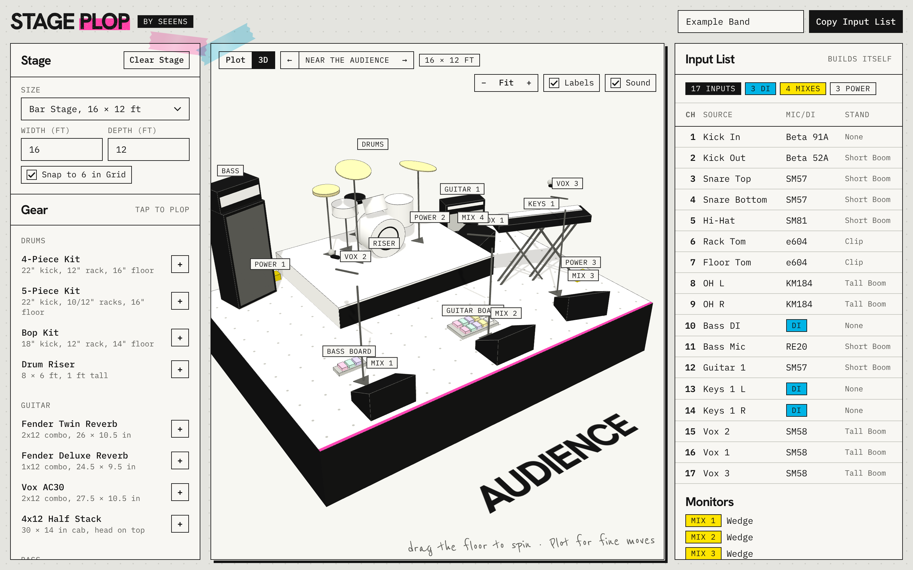

# Stage Plop

Stage plots that don't suck. Plop gear on a stage, move it around, and the input list builds itself. Part of the [Seeens](https://www.seeens.com) family.

**Try it:** [stageplop.com](https://www.stageplop.com/)



## What works now

- Gear library with real footprints: kits and a riser, guitar and bass rigs, Pedaltrain boards, keys, vocal mics, wedges, DI boxes and power drops.
- **Add Gear** (press `/`): search by name, brand or nickname ("fridge" finds the SVT), forgiving of typos. Arrow keys and Enter plop gear without closing, so you can add a whole backline in a row. Browsing by category is in the same drawer, which is a bottom sheet on phones.
- **Plot view** (default) for arranging: straight overhead, drag to move, drag the magenta dot to rotate (15° steps), alignment guides, a 6 in snap grid, arrow keys to nudge.
- **3D view** for looking: drag empty space to orbit, or jump between four preset angles.
- The input list, monitor mixes and power drops come from what's on the stage, in engineer order (drums, bass, guitar, keys, vocals). **Copy Input List** copies them as tab-separated text.
- **Generic pieces** in every category (Guitar Combo 1x12, Head on 4x10 Cab, Synth on a Table, Laptop on a Stand, Percussion Table, Instrument Mic…) for gear that isn't listed by name.
- **Custom pieces** for anything else: name it, pick a shape, enter the size (in or cm) and inputs. Custom pieces save with the plot, can be edited and duplicated, and their inputs land in the input list.
- **Your Rig:** everything you've plopped, custom pieces included, sits at the top of Add Gear, newest first. Your custom pieces also show up in search.
- **Setups:** save the whole stage as a named setup (Full Backline, Acoustic Duo) and add it to any plot or replace the plot with it. A setup from a bigger stage squeezes to fit. Rig and setups save in the browser for now and move to the band with share links (#11).
- Stage size, snap and Clear Stage live on the stage size tag.
- **Your Plots:** keep several plots in this browser and switch between them.
- **Share:** one click makes a **view link** (`/p/…`, look-only, for venues and engineers, with the input list and a Copy button) and an **edit link** (`/edit/…#k=…`) for the band. No account needed. Shared plots save online a moment after each change, and opening the edit link on another device brings the plot there. **Make a New Edit Link** turns off the old one if it leaks.

## Next

- A print-ready plot sheet (PDF: plot, input list, mixes, contact).
- Connect to Seeens: attach a plot to a claimed band profile.
- Better gear models and per-gear sounds.

## Develop

```sh
npm install
cp .env.example .env.local   # then set PLOT_STORE=memory, or fill in Upstash
npm run dev
```

Without a store, sharing is off (the app says so) and everything else works. `PLOT_STORE=memory` keeps shared plots in memory for local testing; they're gone when the server restarts.

### Share links in production

1. In the Vercel project, go to **Storage** (or the Marketplace), add **Upstash Redis** on the free plan and connect it to this project. That sets `KV_REST_API_URL` and `KV_REST_API_TOKEN`.
2. Add `RATE_LIMIT_SALT` (any long random string).
3. Redeploy.

The browser never talks to Redis. Everything goes through `/api/plots`, which checks edit tokens (only their SHA-256 is stored), limits new plots to 20 an hour per address, and caps plots at 300 pieces and 200 KB. Each plot is one key (`plot:<id>`); a typical plot is a few KB.

## Checks

Checks: `npm run lint`, `npm run format:check`, `npm run typecheck`, `npm test`, `npm run build`.

## Layout

- `src/data/gear/*.json` the gear catalog, one file per category. See [Adding Gear](#adding-gear).
- `src/lib/gear.ts` loads the catalog; `src/lib/gear-schema.ts` defines and checks it.
- `src/lib/plot.ts` plot data and everything derived from it (input list, copy text, parsing saved plots). Pure, tested in `plot.test.ts`.
- `src/lib/stage/` the Three.js side: `engine.ts` (scene, camera, pointer handling), `builders.ts` (gear models), `sound.ts` (the plop).
- `src/lib/share.ts` share link ids, tokens and checks; `src/lib/local-plots.ts` the plots kept in the browser; `src/lib/server/` the plot store (Upstash Redis or memory) used by `src/app/api/plots/`.
- `src/components/` the React UI around the stage; `src/app/p/[id]` is the view page and `src/app/edit/[id]` opens edit links.

## Adding Gear

Gear lives in `src/data/gear/`, one JSON file per category. Adding a piece is one entry and no code:

```json
{
  "id": "superReverb",
  "name": "Fender Super Reverb",
  "brand": "Fender",
  "aliases": ["super", "super reverb", "4x10 combo", "guitar amp"],
  "note": "4x10 combo, 24.5 × 10.5 in",
  "label": "Guitar",
  "numbered": true,
  "shape": { "kind": "combo", "w": 24.5, "h": 27, "d": 10.5, "grill": "light" },
  "inputs": "mic"
}
```

- **Sizes are inches**, from the maker's spec sheet. Within an inch is fine.
- **`id`** is camelCase and unique across all files. Saved plots refer to it, so don't rename one that's shipped.
- **`label`** is what the piece is called on stage. With `"numbered": true` it becomes "Guitar 1", "Guitar 2" and so on.
- **`aliases`** are other names people search for, in lowercase.
- **`shape.kind`** picks the 3D model: `kit`, `riser`, `combo`, `stack`, `board`, `keys`, `table`, `mic`, `wedge` or `box`. Each needs its own size fields; `src/lib/gear-schema.ts` lists them.
- **`inputs`** is a preset (`none`, `mic`, `di`, `stereo-di`, `di+mic`, `vocal`) or a list of `{ "name", "source", "stand" }`. `{L}` in a name becomes the piece's label.
- Flags: `handed` (kits that can be flipped for a lefty), `riser`, `monitor`, `power`.

A new category file also needs adding to `GEAR_FILES` in `src/lib/gear.ts`.

`npm test` checks every entry and names the file, entry and field when something's wrong.
